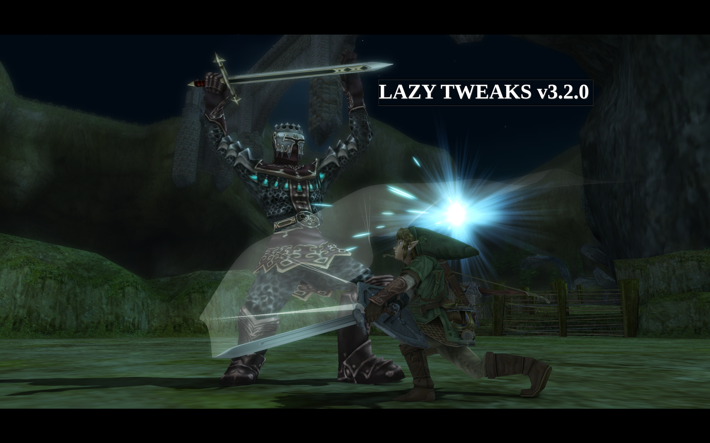

# Kamilink's Lazy Tweaks

A custom build/fork of TwilitRealm's PC port for The Legend of Zelda: Twilight Princess, Dusklight focusing on enhancing difficulty customization, combat depth, enemy AI, and quality of life.

  

## AI/LLM Statement:
I am fairly strict about AI usage. No AI-generated code has been used in Lazy Tweaks--all features are my own work unless otherwise stated. I do occasionally consult an LLM if I absolutely cannot make sense of something in TP's extremely messy codebase, but this is rare and I otherwise often spend entire days on trial-and-error or ask questions in the TwilitRealm Discord before I fallback to that. Please note that I do not wish to imply disrespect towards other modders who are transparent about their AI-usage; it is simply a limitation I set for myself as I want to become the best programmer I can be through my own merit. Please understand that this may drastically increase the amount of time it takes for me to work on this mod, so I can only hope what I put out makes everyone's patience well worth it.
This was mainly a fun side project for me as someone who is pretty new to C++ and was, until about two weeks ago, completely unfamiliar with the decomp code. I started this intending just to see what I could do and how much I could do on my own, but I also saw a lot of people in the Dusklight discord asking for some of these features, so I decided to release it as a mod/custom build.

## Presets (for those who don't want to waste time tinkering)
- **Fior di Battaglia**: the intended Lazy Tweaks experience, a full combat rebalance that starts gentle and ramps up in the second half of the game.
- **Vanilla Plus**: closer to the original game, just more engaging.
- **Deathwish**: am I not enough for you?

## Combat
- **Manual Shielding**: Link no longer raises his shield automatically when locking on. Shield Attack moves to R+B.
- **Crouch Shielding**: crouch behind your shield, plus crouch stabs and swings, like the N64 Zelda games.
- **Parry**: shield bash right before an attack lands to parry it.
- **Deflect**: an alternate parry based on timing your block instead of a shield bash.
- **Combined Parrying**: use both Deflect and Parry, with a new Riposte follow-up on B after a successful parry.
- **Rolling while shielded**: side roll and back roll by pressing A and a direction while locked on and shielding.
- **Attack Dodge Cancel**: dodge out of some basic attacks with R+A.
- **Progressive Combo Damage**: each hit in a combo does a bit more damage than the last.
- Dodges give invincibility frames, and guard breaks are more punishing.
- Jump Strike charges faster and can be charged in the middle of a combo.

## Skill Meter
- A new meter (built from the game's unused magic meter) that limits how often you can use powerful moves like Midna Charge, Wolf jump attacks, Shield Attack, Helm Splitter, and Back Slice.
- Optional: make blocking and the Great Spin use the meter too.
- Optional: exclude Wolf jump attacks or Midna Charge from the meter.

## Wolf Link
- New spot-dodge on **Z**, with a follow-up attack on **B**.
- Faster attacks, a restored unused scratch attack as the third combo hit, and Ending Blow on more than just poes.
- **Sturdier Wolf Link**: Wolf Link no longer takes double damage. Makes Twilight sections less ass on higher damage multipliers.

## Enemies & Bosses
- Reworked behavior for many common enemies, including Bokoblins, Bulblins, Lizalfos, Dynalfos, Darknuts, Skulltulas, Deku Babas, Big Baba, Baba Serpents, and Shadow Beasts. They're generally faster, more aggressive, and smarter about fighting back.
- Tougher bosses, including Diababa, Fyrus, King Bulblin, Death Sword, Darknut (1v1), and a big Ganondorf rework.

## Difficulty & Penalties
- **Sword**, **Bow**, and **Wolf Damage Multipliers**.
- **Progressive Damage Multiplier**: an additional 2x damage multiplier is added to your existing damage multiplier setting in the second half of the game for a smoother difficulty curve (2x becomes 4x, 4x becomes 6x, etc.).
- **Death Rupee Tax**: lose a set amount, half, or a quarter of your rupees when you die.
- **Adjustable Heart Drop Rate**, **No Arrow Drops**, and **No Rupee Drops**.
- **Insulated Zora Armor**: no more weakness to ice and fire.

## Quality of Life
- Auto update checker, like the main Dusklight branch; takes you to latest Github release.
- Independent data directory from main Dusklight install.
- Assign items to the **Z button** from the item wheel. Compatible with Twilit Essential's Quick Select feature and Olivia!!!'s Extra Items mod!
- Faster bottle drinking, faster swimming/swim dashing with and without Zora armor.
- **Suppress Button Prompts**: hide prompts that experienced players don't need.
- **Easy Quick Spin** cheat (Cheats tab) now uses R + Left/Right.

## Visuals & Audio
- **Always Glowing Light Sword**: keep the Master Sword's glow after the Sols, either just visually or with the damage boost.
- **More Prominent Sword Trail**.
- **Shadow/Translucent Midna** or **Invisible Midna** while riding on Wolf Link.
- - **Always Show Gear As Wolf**: keep the sword and shield visible on Wolf Link.
- **No Hitstop**: remove the brief freeze when attacks connect.
- **No Battle Music** and **Mute All Music** options.

## HUD stuff for mod compatibility
- **Z-Item Scale**, **Hide Z Button Ammo**, and **Hide Midna Icon**.
- Move the **Midna icon** and **Skill Meter** anywhere on screen.

## On mod compatibility
Mod compatibility with big mods is always going to be finnicky at times, even on vanilla Dusklight. However, most mods are compatible out of the box! For those big mods that touch a lot of things (Twilit Essentials, Dawnlight, A Link Between Twilight, etc.), be sure to configure their settings so as to not conflict with existing Lazy Tweaks features. The big one is Z-items, which Lazy Tweaks already comes with natively. Disable it and any other potentially conflicting features and you should be good. I personally use Twilit Essentials and have had an incredibly smooth experience (thanks to Fimmel).

## INSTRUCTIONS:
Windows: extract into its own folder and launch. Uses its own data directory at %AppData%\Kamilink\LazyTweaks by default. You can port over your existing Dusklight settings by just copy and pasting the contents of %AppData%\TwilitRealm\Dusklight to the new directory.

Linux: extract and launch the appimage from anywhere. Make executable if needed, depending on your system. Uses its own data directory at /home/yourusername/.local/share/Kamilink/LazyTweaks/. You can port over your existing Dusklight settings by just copy and pasting the contents of /home/yourusername/.local/share/TwilitRealm/Dusklight/ to the new directory.

Android: Download, install, and launch. Backup your data folder beforehand just in case, but it should be installed as its own app/package with its own data, so you no longer need to uninstall vanilla Dusklight.

iOS: Sideload to iOS using iloader or something similar. For more detailed instructions, see Dusklight's official github.

Mac: Not sure, don't have a mac to test on. Extract and launch probably?

## ORIGINAL DUSKLIGHT README:

  

  

    <a href="https://twilitrealm.dev">Official Website</a>
    •
    <a href="https://discord.gg/6NpMhefCK9">Discord</a>
  

# Overview

Dusklight is a reverse-engineered reimplementation of Twilight Princess.

It aims to be as accurate as possible to the original while also providing new options, enhancements, and tools to customize your experience.

> [!IMPORTANT]
> Dusklight's official website is https://twilitrealm.dev/, any other website is not affiliated and may be promoting AI-generated misinformation.

# Setup

> [!IMPORTANT]
> Dusklight does *not* provide any copyrighted assets. You must provide your own copy of the original game.

> [!IMPORTANT]
> At a minimum, Dusklight requires a GPU with support for D3D12, Vulkan 1.1+, or Metal. For older devices, best-effort support is provided for D3D11 and OpenGL ES (Android), but will not achieve full accuracy or performance. Your experience with specific hardware, operating systems, and drivers may vary.

### 1. Dump your game

You must dump your own copy of the game. Please see [this article](https://wiki.dolphin-emu.org/index.php?title=Ripping_Games) for instructions. After dumping, you can use a program like [Dolphin](https://dolphin-emu.org/) or [nodtool](https://github.com/encounter/nod/releases) to convert the `.iso` to `.rvz` to save space.

Dusklight currently supports all commercial discs except for Wii's Korean release.

> [!NOTE]
> Dusklight is based on the [Twilight Princess decompilation](https://github.com/zeldaret/tp), which is currently only matching for GameCube. As a result, even when playing Dusklight with a Wii disc, you will be presented with the GameCube version's HUD and certain other specificities.

### 2. Install Dusklight

Visit the [official installation guide](https://twilitrealm.dev/install/) for full instructions.

# Building

If you'd like to build Dusklight from source, please read the [build instructions](docs/building.md).

Pull requests are welcomed! Note that we do not accept contributions that are primarily AI-generated and will close your PR if we suspect as much. Please also see the [code conventions](docs/code-conventions.md).

# Credits

Special thanks to the [TP decompilation](https://github.com/zeldaret/tp) team, the GC/Wii decompilation community, the [Aurora](https://github.com/encounter/aurora) developers, the [TP speedrunning community](https://zsrtp.link), and all [contributors](https://github.com/TwilitRealm/dusklight/graphs/contributors).

 

    

